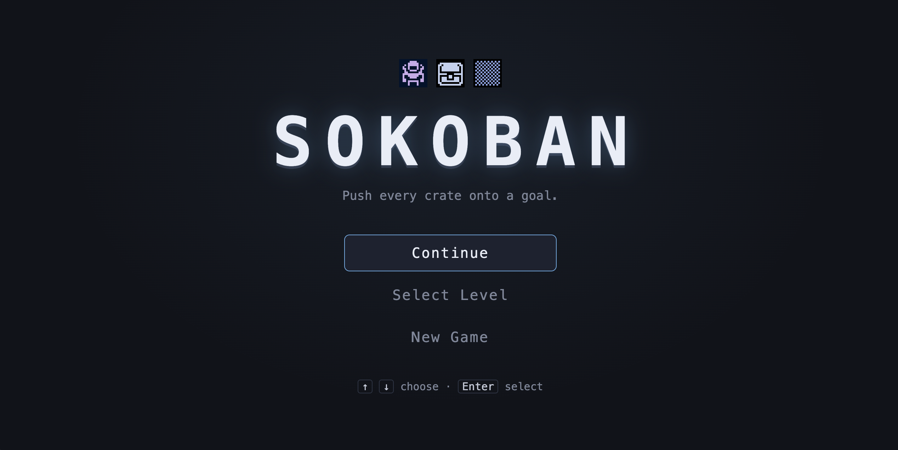
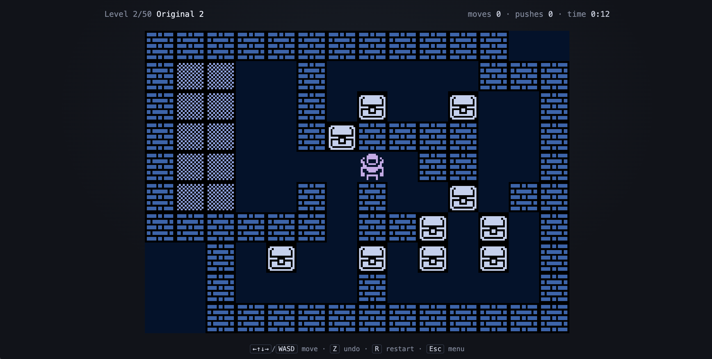

# Sokoban

Push every crate onto a goal. [Demo](https://frycz.github.io/sokoban/)

- `npm run game` — the game as players get it (http://localhost:5173)
- `npm run dev` — the same game plus dev tools: all levels view, reordering, playing from any level, win level (http://localhost:5175)
- `npm run editor` — the level editor (http://localhost:5174)
- `npm run build` — builds the game to `dist/`
- `npm run verify` — format, lint, knip, types, tests

See `architecture.md` for how it fits together.
